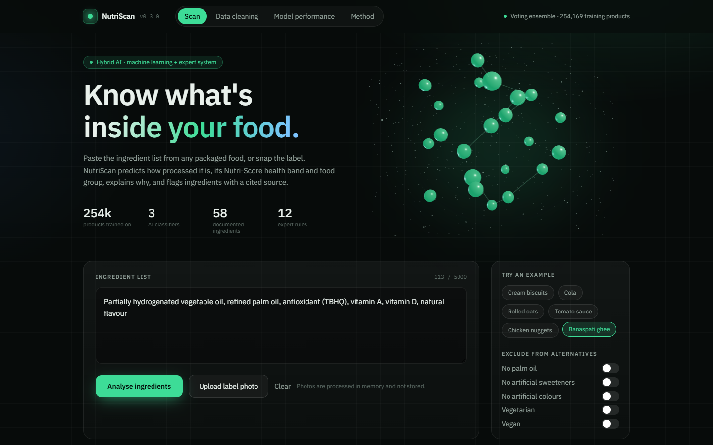
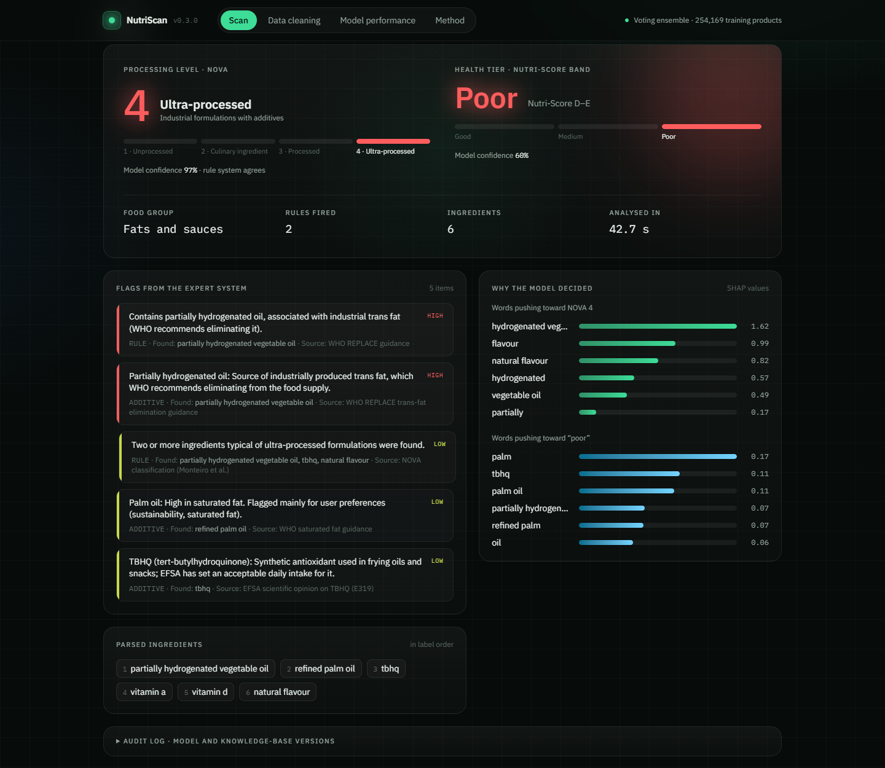
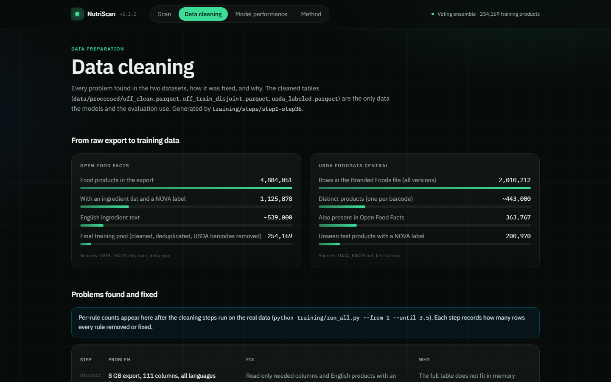
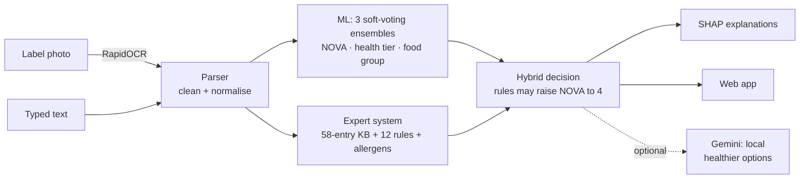

# NutriScan

**AI-powered ingredient label analyzer.** Paste an ingredient list or snap a photo of a food label, and NutriScan
predicts how processed the product is (NOVA 1–4), its Nutri-Score health tier and its food group, explains *why*
with SHAP, flags additives and allergens with cited sources, and suggests healthier options.




## Highlights

- **Trained on 254,169 real products** from Open Food Facts, after cleaning a 4.9-million-row, 8 GB export with DuckDB.
- **Tested on a second, independent dataset:** 200,970 USDA FoodData Central products whose barcodes were removed
  from training. NOVA classification reaches **93.2% accuracy and 0.767 macro-F1** on them.
- **Hybrid AI:** a soft-voting ensemble (logistic regression, linear SVM, random forest, gradient boosting) for each of
  three targets, plus a rule-based expert system with a 58-entry, source-cited knowledge base and 12 IF–THEN rules.
- **Explainable:** exact SHAP values for the linear model show which ingredients pushed each prediction.
- **Leakage-aware evaluation:** brand-grouped splits and cross-validation, overlap removal between datasets, and
  macro-F1 as the headline metric for a 37:1 class imbalance.
- **Label OCR** (RapidOCR + OpenCV) that straightens tilted photos and survives glare; the text stays editable.
- **Full-stack app:** FastAPI backend, Next.js + React front end with a three.js scene, and a data-cleaning page that
  documents every preprocessing rule.

| Prediction with explanations | Data cleaning page |
|---|---|
|  |  |

## How it works



1. **Parse.** The label text is lower-cased, percentages, "may contain" tails and footnotes are removed, E-numbers are
   normalised (`E 102` → `e102`), and brackets are split into sub-ingredients while keeping order (≈ quantity).
2. **Classify.** Three ensembles read TF-IDF features (word 1–2-grams and character 3–5-grams, about 2 million terms)
   and 20 engineered features (ingredient counts, E-numbers, position of sugar and fat, additive markers).
3. **Check rules.** The expert system flags additives and patterns (for example partially hydrogenated oil, or a colour
   + flavouring + emulsifier combination), produces allergen warnings, and may raise the NOVA group to 4 — always with
   the rule and source shown.
4. **Explain and suggest.** SHAP values highlight the driving ingredients. An optional Gemini layer suggests healthier
   products available locally; it is labelled in the UI and never changes the model's prediction.

## Models

| Member | Features | Tuned parameters (NOVA model) |
|---|---|---|
| Logistic regression | TF-IDF words + characters | C = 22.6, balanced class weights |
| Linear SVM (calibrated) | TF-IDF words + characters | C = 3.98, balanced, 3-fold calibration |
| Random forest | 20 engineered features | 341 trees, max depth 20 |
| HistGradientBoosting | engineered features + 100-d LSA embedding | learning rate 0.27, 57 leaves |

Hyper-parameters were tuned with `RandomizedSearchCV` and `StratifiedGroupKFold` (grouped by brand, scored by
macro-F1). Class imbalance was handled with class weights; random oversampling and SMOTE (dense features only) were
compared in the same pipeline.

## Results

Unseen USDA products (barcodes removed from training), first full training run:

| Target | Products | Accuracy | Macro-F1 |
|---|---:|---:|---:|
| NOVA group (4 classes) | 200,970 | 0.932 | 0.767 |
| Health tier (3 classes) | 177,635 | 0.727 | 0.641 |
| Food group (11 classes) | 123,365 | 0.818 | 0.644 |

On the brand-held-out Open Food Facts test set, the best single model (TF-IDF + linear SVM) scored 0.838 macro-F1,
against 0.215 for the majority-class baseline, which is 75.6% *accurate* — the reason macro-F1 is the headline metric.
Per-class scores, confusion matrices and the full comparison are on the app's **Model performance** page.

## Tech stack

| Area | Tools |
|---|---|
| Data | pandas, PyArrow, DuckDB, NumPy |
| ML | scikit-learn, imbalanced-learn, SHAP |
| OCR | RapidOCR (ONNX Runtime), OpenCV |
| Backend | FastAPI, Uvicorn |
| Frontend | Next.js 16, React 19, TypeScript, Tailwind CSS, three.js (react-three-fiber), Framer Motion |
| Other | Google Gemini API (optional), pytest, Jupyter |

## Getting started

Requirements: Python 3.11+ (tested on 3.14), Node.js 20+. Photo OCR on Windows also needs the Microsoft Visual C++
Redistributable (x64).

```bash
git clone https://github.com/mugheessubtain/NutriScan.git
cd NutriScan
python -m venv .venv
.venv\Scripts\activate            # Linux/macOS: source .venv/bin/activate
pip install -r requirements.txt
cd web && npm install && npm run build && cd ..
```

Trained models are not stored in the repository (1–2.5 GB each). Train them (below) or place `nova_model.joblib`,
`tier_model.joblib`, `category_model.joblib` and `train_meta.json` in `artifacts/`. Then start the app:

```bash
start.bat                          # Windows: starts the API (port 8000) and the website (port 3000)
# or manually, in two terminals:
python -m uvicorn server:app --app-dir runtime/api --port 8000
cd web && npm run start            # http://localhost:3000
```

Optional: copy `.env.example` to `.env` and set `GEMINI_API_KEY` to enable the local-suggestions feature.

### Training

Download the data into `data/raw/`:

| File | Source |
|---|---|
| `food.parquet` (~8 GB) | [Open Food Facts on Hugging Face](https://huggingface.co/datasets/openfoodfacts/product-database) |
| Branded Foods CSV zip | [USDA FoodData Central](https://fdc.nal.usda.gov/download-datasets) |

```bash
python training/run_all.py                    # full pipeline: prepare -> steps 1-8
python training/run_all.py --from 1 --until 3.5   # cleaning steps only
python training/run_all.py --demo             # smoke test on a synthetic sample (writes to ./_demo_out)
pytest                                        # 58 tests; outputs go to a temporary folder
```

| Step | Script | Purpose |
|---|---|---|
| 0 | `prepare_off.py` | Filter the 8 GB Parquet export with DuckDB |
| 1–2 | `step1_load_data`, `step2_preprocess` | Deduplicate, parse and normalise ingredient text |
| 2b | `step2b_eda` | EDA: 11 plots and summary tables for both datasets |
| 3–3b | `step3_make_unseen_set`, `step3b_usda_targets` | Join USDA, build the unseen test set, add USDA labels |
| 6 | `step6_compare_models` | Baselines, four models, tuning, ensembles, imbalance comparison |
| 4 | `step4_train_models` | Train and save the final ensembles |
| 5, 7, 8 | evaluation steps | Unseen test, ablation, OCR robustness, fairness, SHAP, alternatives |

Every cleaning rule records its before/after row counts in `reports/tables/cleaning_log.json`, which the
**Data cleaning** page displays.

## Project structure

```
runtime/
  src/nutriscan/        parser, features, models (zoo + predictors), expert_system, explain (SHAP),
                        eda, usda, ocr, alternatives, llm_suggest, pipeline
  knowledge_base/       additives.yaml (58 entries), rules.yaml (12 rules, allergens, preferences)
  api/server.py         FastAPI endpoints used by the web app
training/               run_all.py, prepare_off.py, steps/ (numbered pipeline)
web/                    Next.js app: Scan, Data cleaning, Model performance, Method
notebooks/              EDA and results walkthroughs
samples/                test label images with ground-truth text
tests/                  pytest suite
docs/                   data facts, limitations, screenshots
```

## Limitations

- Open Food Facts derives NOVA partly from ingredient markers, so the NOVA model partly re-learns that rule; the
  health tier (computed from nutrients) and the cross-dataset test are the stronger evidence.
- NOVA 2 (culinary ingredients) is 1.8% of the data and the weakest class (F1 0.43).
- The data is mostly European and North American, English-language only.
- The three ensembles need about 5 GB of RAM; lighter single models predict much faster.
- Not medical advice. Allergen detection is keyword-based and should be checked against the actual label.

## Team

Built by **Mughees Subtain** and **Shaheer** as a Complex Computing Activity for *Programming for Artificial
Intelligence* (CT-264) at NED University of Engineering & Technology, Karachi.

## Data and attribution

Contains data from [Open Food Facts](https://world.openfoodfacts.org), available under the
[Open Database License](https://opendatacommons.org/licenses/odbl/1-0/). Product data also from
[USDA FoodData Central](https://fdc.nal.usda.gov) (public domain). NOVA classification: Monteiro et al., *Public Health
Nutrition*, 2019.
